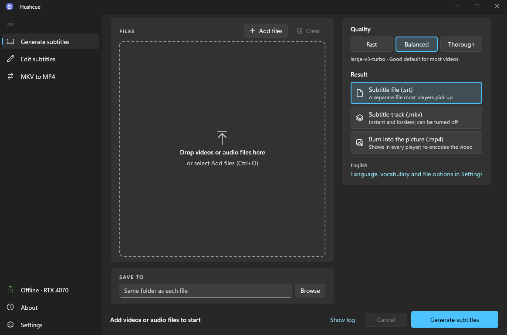
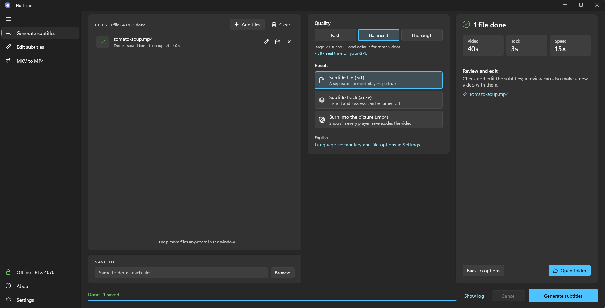
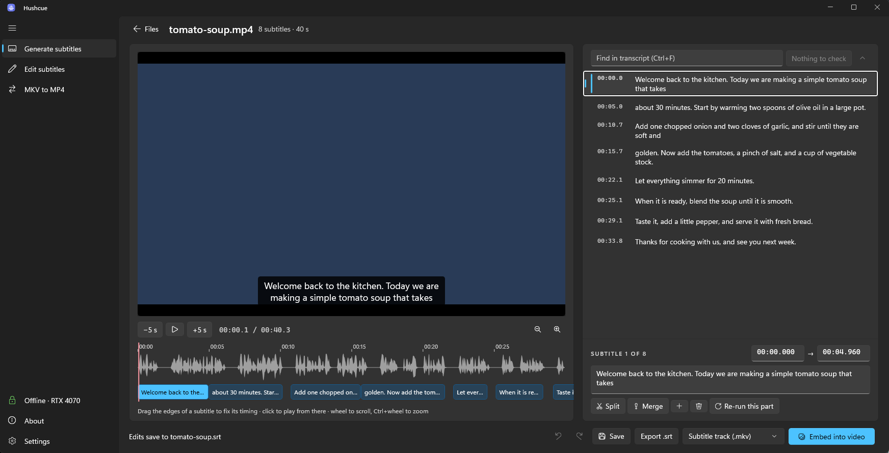

# Hushcue

Accurate subtitles from any video, generated privately on your PC.

Hushcue turns the speech in your videos into subtitles with Whisper, running entirely on your own machine.
It can save an `.srt` file, add a subtitle track to an `.mkv`, or burn the text into an `.mp4`.

**Download**: the installer is on the [Releases page](https://github.com/iStorry/hushcue/releases/latest)
(Windows 10 1809 or later, x64). Hushcue needs [ffmpeg](https://ffmpeg.org) on PATH (`winget install Gyan.FFmpeg`).
On first run it downloads the speech model (about 1.6 GB) and, with an NVIDIA GPU, NVIDIA's cuBLAS (about 630 MB);
without a GPU it runs on the CPU. The installer is not code-signed yet, so SmartScreen may warn: More info, Run anyway.

Hushcue is a native Windows app (C# + WinUI 3). It runs OpenAI's Whisper through CTranslate2, called directly
from C# through a small C++ bridge, with a C# port of faster-whisper's decoding. What's next: [TODO.md](TODO.md).



| Finished | Review and edit |
|---|---|
|  |  |

Drop videos or audio files on the window (or use Add files), pick the quality and the result, and start. Each file
shows its own progress; the bottom bar shows the whole batch and the time left, as does the taskbar button. Files
that can't be done are flagged before the run (not media, no sound, or no picture to put subtitles on). The finished
screen sums up the batch and can put originals moved to the Recycle Bin back.

Keyboard: Ctrl+O add files, Ctrl+Enter start, Delete remove the selected files, Esc cancel (asks first), arrow keys
within the quality and result choices. `HUSHCUE_THEME=Light` or `Dark` pins the theme and `HUSHCUE_SETUP=1` shows
the setup screen as on a fresh PC, and `HUSHCUE_NEW_INSTANCE=1` opens a separate window even when Hushcue is already
running (all for testing and screenshots).

## Layout

| Project | What it is |
|---|---|
| `src/Hushcue.Core` | Settings, subtitle cleanup, SRT, pipeline, ffmpeg and engine wrappers. No UI. |
| `src/Hushcue.Cli` | Console front end, used for benchmarks and scripting. |
| `native/hushcue_ct2` | C interface over CTranslate2's Whisper model, built by `native/build.ps1`. |
| `tools/bench` | Scripts that check the C# engine against faster-whisper and write the test fixtures. |
| `eval/lookalike` | Spoken test passages for `Hushcue.Cli eval`: words that sound alike, and names with a vocabulary. |
| `src/Hushcue.App` | The WinUI 3 desktop app. |
| `tests/Hushcue.Core.Tests` | xUnit tests for Core. |

## Using it

The sidebar holds the three tools:

- **Generate subtitles**: drop videos or audio, pick a quality and what you get (an `.srt`, a subtitle track, or
  text burned into the picture), and run. **Review and edit** then goes through what is worth checking: phrases
  Whisper invents over silence, loops, long gaps, and words it was **not sure** of that sound like other words
  (calm / come / cum, their / there, principle / principal, ...). Those come with one-click swaps to the other
  spellings; "Looks fine" keeps the word.
- **Edit subtitles**: open a video with subtitles it already has (`talk.srt` or `talk.en.srt` next to `talk.mp4`
  is found by name), check them against the picture, fix text and timing, then save the `.srt` or put it into a copy
  of the video. Dropping a video with its `.srt`, or right-clicking an `.srt` in Explorer and choosing **Edit
  subtitles with Hushcue**, opens it here too. Nothing is transcribed unless you re-run a part.
- **MKV to MP4**: remove the subtitle tracks from `.mkv` files and save them as `.mp4` without re-encoding.

**Settings** holds the choices that rarely change (language, vocabulary, audio clean-up, skipping silence, what happens
to the files when subtitles go into the video, the theme, automatic updates), and shows where transcription runs on
this PC. **About** has the version, "Check for updates", the source code and the third-party notices.

**Updates**: once a day on start, Hushcue asks GitHub whether there is a newer release and offers to install it. The
installer is checked against the release's `SHA256SUMS.txt`, Hushcue closes, updates and opens again. A portable copy
is pointed at the release page instead. Turn it off in Settings.

## Install

Windows 10 (1809) or 11, x64. From a [release](https://github.com/iStorry/hushcue/releases):

- `Hushcue-<version>-setup.exe` installs for your user account (no admin needed), adds a Start menu entry and, if
  you keep the option ticked, "Generate subtitles with Hushcue" on the right-click menu of video and audio files.
- `Hushcue-<version>-win-x64.zip` is the same app, portable: unzip anywhere and run `Hushcue.exe`.

Hushcue needs ffmpeg on PATH: `winget install Gyan.FFmpeg`. On first use it downloads the speech model (1.6 GB) and,
on a PC with an NVIDIA GPU, NVIDIA's cuBLAS (630 MB) into `%LOCALAPPDATA%\Hushcue`; without a GPU it runs on the CPU,
more slowly. Nothing else leaves your PC.

## Build

Needs the .NET 10 SDK (pinned in `global.json`) on Windows 10 1809 or later, x64. The engine bridge also needs
Visual Studio 2022 or later Build Tools (C++ workload), CMake, and a Python environment with the `ctranslate2==4.8.2`
wheel, plus `nvidia-cublas-cu12` to run on the GPU during development. By default the scripts look in
`native\deps\site-packages`:

```bash
python -m pip install --no-deps --target native/deps/site-packages ctranslate2==4.8.2 nvidia-cublas-cu12
```

```bash
powershell -ExecutionPolicy Bypass -File native/build.ps1
dotnet build Hushcue.slnx
dotnet test Hushcue.slnx
dotnet run --project src/Hushcue.App
```

**On a Mac** (Apple Silicon), Core, the CLI and the tests build and run on the CPU; the app itself is Windows only.
`native/build.sh` builds the bridge against the macOS `ctranslate2` wheel and puts it, with the CTranslate2 dylib, in
`native/bin`. It needs the Xcode command line tools and CMake. Burning text into a video needs an ffmpeg with libass:
Homebrew's `ffmpeg` has none, `ffmpeg-full` does.

```bash
python3 -m pip install --no-deps --target native/deps/site-packages ctranslate2==4.8.2
native/build.sh
dotnet test tests/Hushcue.Core.Tests
dotnet run --project src/Hushcue.Cli -- job --out out video.mp4
```

## Release

```bash
powershell -ExecutionPolicy Bypass -File tools/publish.ps1 -Version 0.2.0 -SmokeTest
powershell -ExecutionPolicy Bypass -File installer/build.ps1 -Version 0.2.0 -Iscc <path to ISCC.exe>
```

`tools/publish.ps1` makes a self-contained folder in `artifacts/publish/Hushcue`; `installer/build.ps1` turns it into
an installer with Inno Setup 6. Pushing a `v*` tag runs the same steps on GitHub (`.github/workflows/release.yml`)
and publishes a release with the installer, a zip and `SHA256SUMS.txt`, which is what the app's updater looks for.
Details, measurements and the ffmpeg and licence choices: [docs/shipping.md](docs/shipping.md).

## Licence

Hushcue is [MIT licensed](LICENSE), by Jatinjit Singh. It ships or downloads other people's work under their own
licences: [THIRD-PARTY-NOTICES.md](THIRD-PARTY-NOTICES.md).
