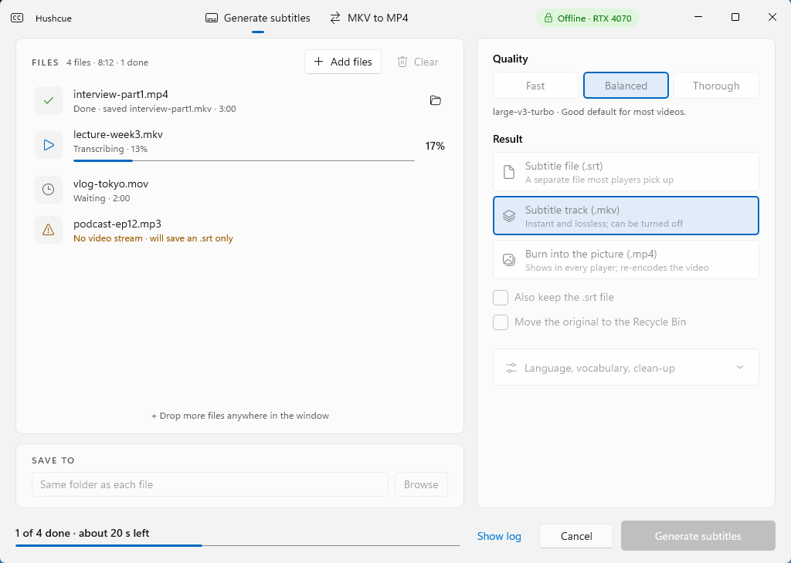
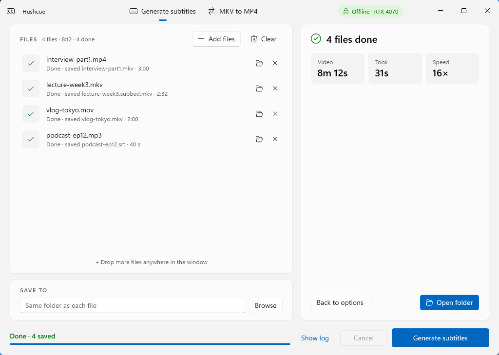
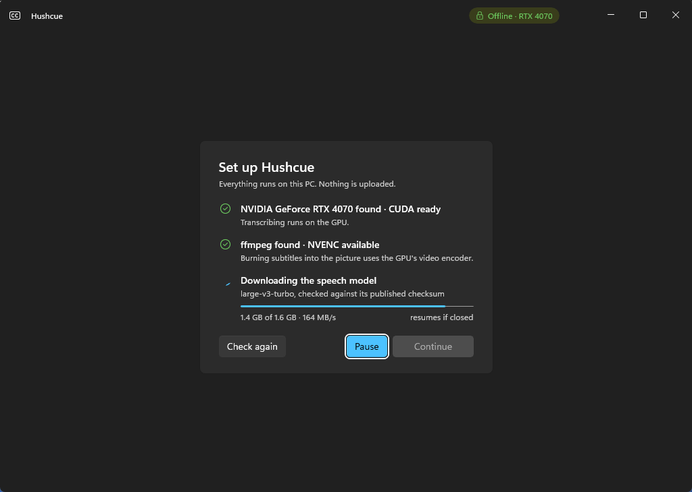

# Hushcue

Accurate subtitles from any video, generated privately on your PC.

Hushcue turns the speech in your videos into subtitles with Whisper, running entirely on your own machine.
It can save an `.srt` file, add a subtitle track to an `.mkv`, or burn the text into an `.mp4`.

> Work in progress: a C# + WinUI 3 rewrite of SubGen. See [TODO.md](TODO.md) for the plan.
> Engine: CTranslate2, the engine SubGen uses, called natively through a small C++ bridge
> ([Phase 1b](docs/phase1b-ctranslate2.md)). Whisper.net was tried first and dropped ([Phase 1](docs/phase1-engine-spike.md)).



| Finished | First run |
|---|---|
|  |  |

Drop videos or audio files on the window (or use Add files), pick the quality and the result, and start. Each file
shows its own progress; the bottom bar shows the whole batch and the time left, as does the taskbar button. Files
that can't be done are flagged before the run (not media, no sound, or no picture to put subtitles on). The finished
screen sums up the batch and can put originals moved to the Recycle Bin back.

Keyboard: Ctrl+O add files, Ctrl+Enter start, Delete remove the selected files, Esc cancel (asks first), arrow keys
within the quality and result choices. `HUSHCUE_THEME=Light` or `Dark` pins the theme and `HUSHCUE_SETUP=1` shows
the setup screen as on a fresh PC (both for testing and screenshots).

## How it compares with SubGen

Same Whisper engine (CTranslate2) and model, called natively instead of through Python. On four 3-minute reference
clips, Balanced preset, RTX 4070 ([details](docs/phase7-results.md)):

| | SubGen (Python) | Hushcue |
|---|---|---|
| Full job, 12 min of audio | 28.9 s | 26.3 s |
| Word error rate vs hand-made references | 55.1% | 49.1% |
| Repeat runs | identical | identical |

## Layout

| Project | What it is |
|---|---|
| `src/Hushcue.Core` | Settings, subtitle cleanup, SRT, pipeline, ffmpeg and engine wrappers. No UI. |
| `src/Hushcue.Cli` | Console front end, used for benchmarks and scripting. |
| `native/hushcue_ct2` | C interface over CTranslate2's Whisper model, built by `native/build.ps1`. |
| `tools/bench` | Benchmark scripts comparing Hushcue with SubGen on the reference clips. |
| `src/Hushcue.App` | The WinUI 3 desktop app. |
| `tests/Hushcue.Core.Tests` | xUnit tests for Core. |

## Install

Windows 10 (1809) or 11, x64. From a [release](https://github.com/iStorry/hushcue/releases):

- `Hushcue-<version>-setup.exe` installs for your user account (no admin needed), adds a Start menu entry and, if
  you keep the option ticked, "Generate subtitles with Hushcue" on the right-click menu of video and audio files.
- `Hushcue-<version>-win-x64.zip` is the same app, portable: unzip anywhere and run `Hushcue.exe`.

Hushcue needs ffmpeg on PATH: `winget install Gyan.FFmpeg`. On first use it downloads the speech model (1.6 GB) and,
on a PC with an NVIDIA GPU, NVIDIA's cuBLAS (630 MB) into `%LOCALAPPDATA%\Hushcue`; without a GPU it runs on the CPU,
more slowly. Nothing else leaves your PC.

## Build

Needs the .NET 10 SDK (pinned in `global.json`) on Windows 10 1809 or later, x64. The engine bridge also needs
Visual Studio 2022 or later Build Tools (C++ workload), CMake, and a Python environment with the `ctranslate2==4.8.2`
wheel, plus `nvidia-cublas-cu12` to run on the GPU during development (SubGen's venv by default).

```bash
powershell -ExecutionPolicy Bypass -File native/build.ps1
dotnet build Hushcue.slnx
dotnet test Hushcue.slnx
dotnet run --project src/Hushcue.App
```

## Release

```bash
powershell -ExecutionPolicy Bypass -File tools/publish.ps1 -Version 0.2.0 -SmokeTest
powershell -ExecutionPolicy Bypass -File installer/build.ps1 -Version 0.2.0 -Iscc <path to ISCC.exe>
```

`tools/publish.ps1` makes a self-contained folder in `artifacts/publish/Hushcue`; `installer/build.ps1` turns it into
an installer with Inno Setup 6. Pushing a `v*` tag runs the same steps on GitHub (`.github/workflows/release.yml`)
and attaches the installer and a zip to a draft release. Details, measurements and the open ffmpeg/licence
decisions: [docs/shipping.md](docs/shipping.md). Third-party licences: [THIRD-PARTY-NOTICES.md](THIRD-PARTY-NOTICES.md).
